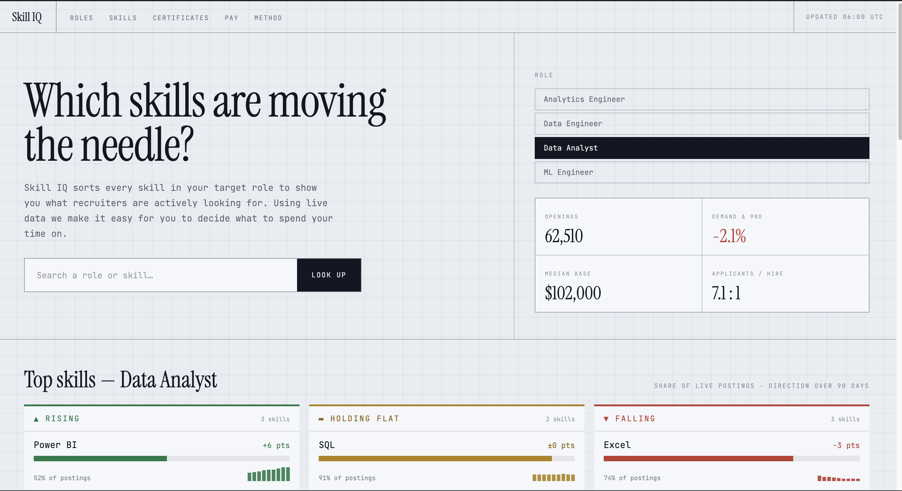
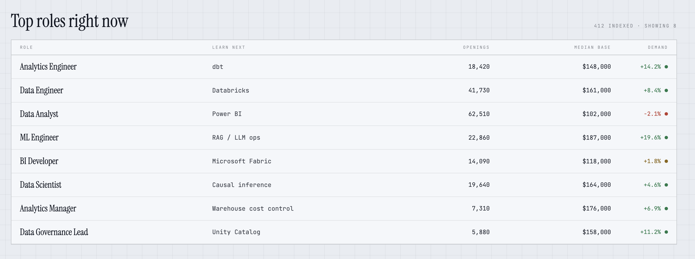
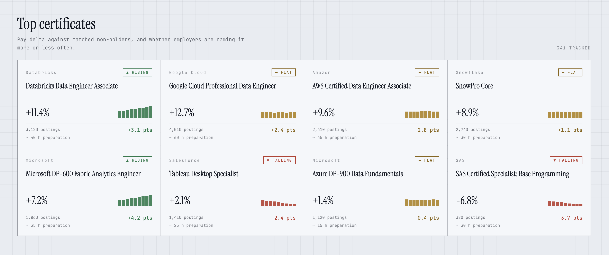

# Skill IQ — Demand Index

> **Note:** Hardcoded values

<p align="center">
  
</p>

## Top roles

<p align="center">
  
</p>

## Top certificates

<p align="center">
  
</p>

## Running locally

```bash
npm install
npm run dev      # Vite dev server
npm run build    # tsc -b && vite build
npm run lint     # oxlint
npm run preview  # serve the production build
```
