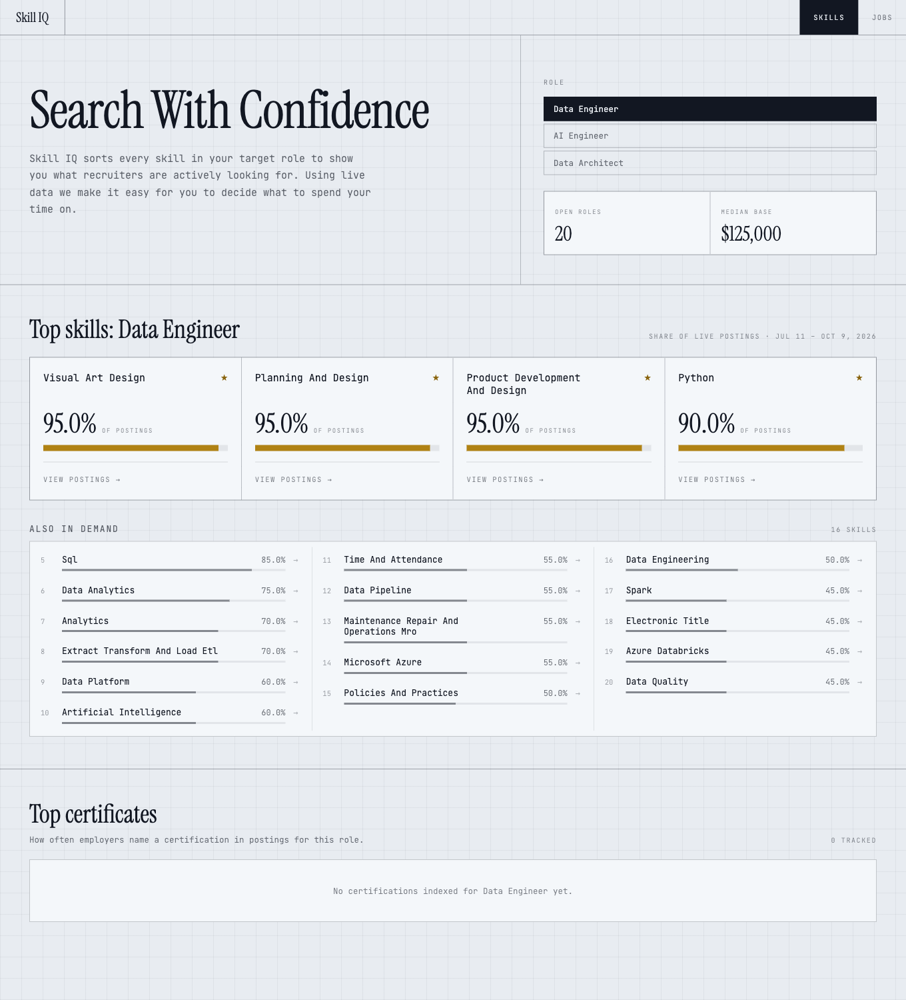
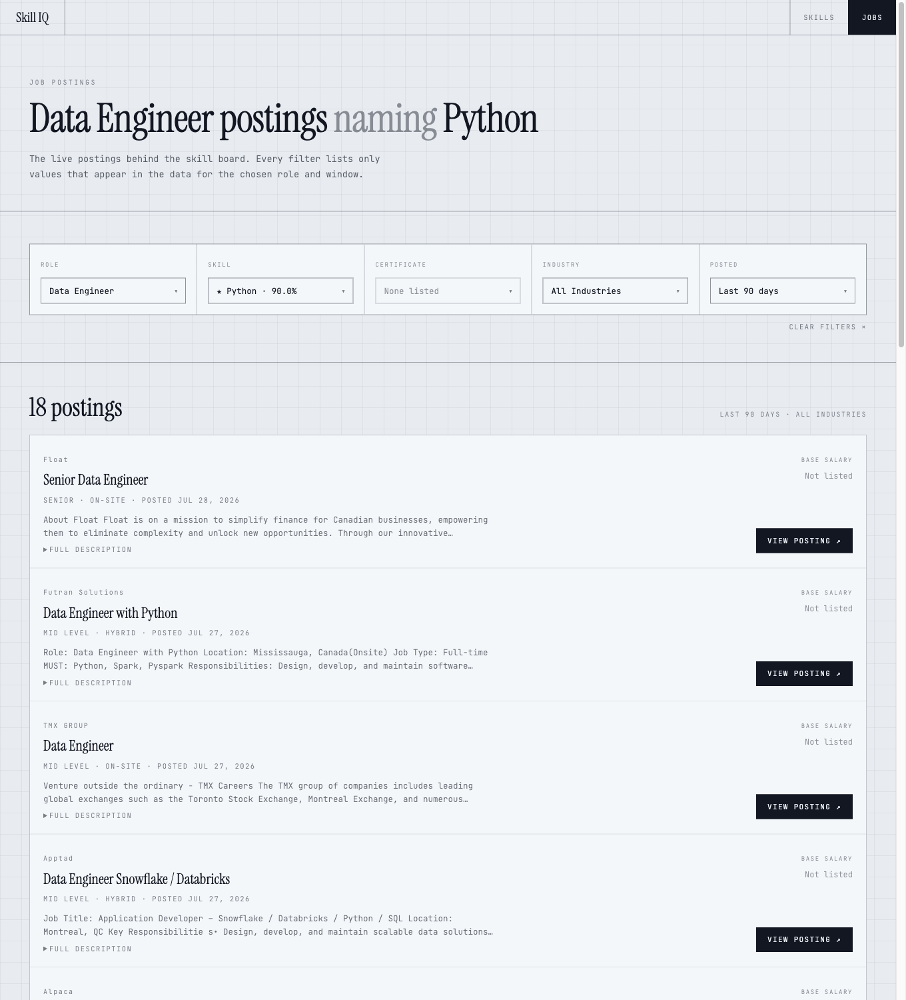

# Skill IQ — Demand Index

Which skills do employers actually ask for? Skill IQ reads live job postings for a role and ranks
every skill by how often postings name it, then links each one straight to those postings.

<p align="center">
  
</p>

## Skill board

Skills named in **90% or more** of a role's postings are core skills: each gets a starred card at
the top. The rest follow in a ranked list flowed across columns. Every skill links to the postings
behind its figure.

## Job postings

<p align="center">
  
</p>

`/jobs` lists the postings for a role, filterable by skill, certificate, industry and posting
window. Every dropdown is populated from the API for the selected role and window, so it only offers
values the data contains. Filters live in the query string (`/jobs?role=data_engineer&skill=Python`),
so any view can be linked to.

## Data

Everything comes from the Skill IQ API (`/api/filters`, `/api/skills`, `/api/certifications`,
`/api/jobs`). The base URL defaults to the hosted instance and can be overridden with
`VITE_API_BASE_URL`. All API access lives in [src/lib/api.ts](src/lib/api.ts).

## Running locally

```bash
npm install
npm run dev      # Vite dev server
npm run build    # tsc -b && vite build
npm run lint     # oxlint
npm run preview  # serve the production build
```

`/jobs` is a client-side route, so whatever serves the production build must fall back to
`index.html` for unknown paths. The Vite dev and preview servers already do.
